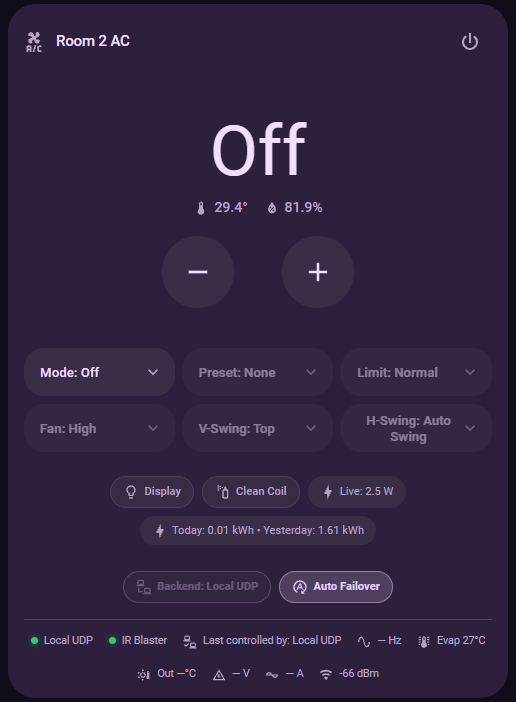
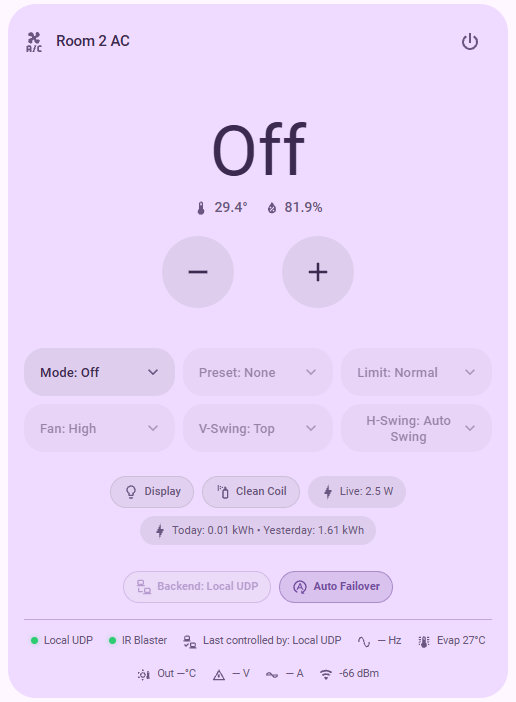
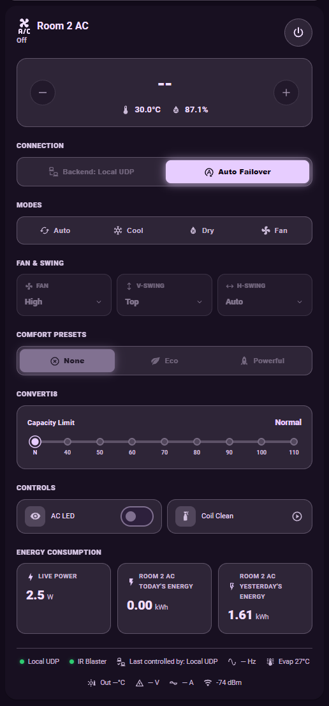
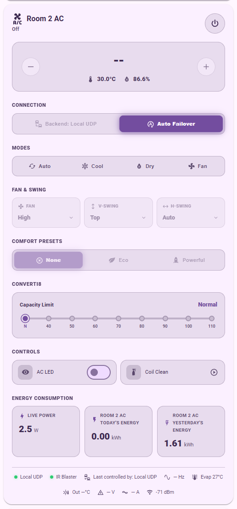
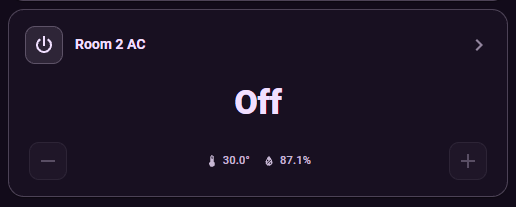
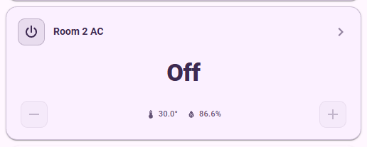
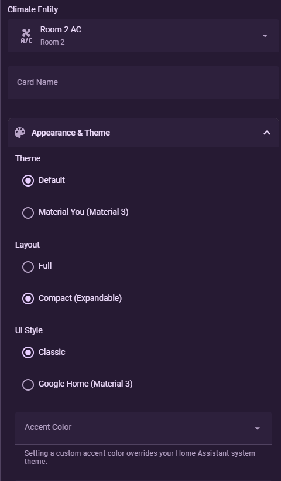
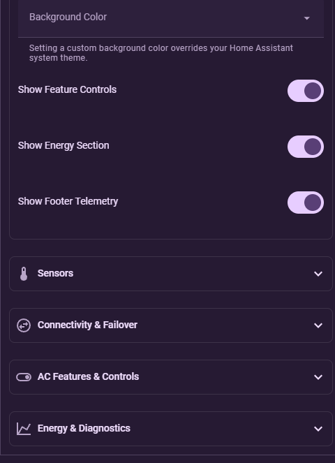

# Panasonic AC India Card (`panasonic-ac-card-in`)

<!-- ha-marketplace:exclude-start -->
<p align="center">
  <a href="https://www.home-assistant.io/integrations/marketplace/"></a>
  <a href="https://github.com/selvakk2k/panasonic-ac-card-in/releases/latest"></a>
  <a href="https://github.com/selvakk2k/panasonic-ac-card-in/releases"></a>
  <a href="https://github.com/selvakk2k"></a>
  <a href="https://aiattribution.github.io/interpret-attribution"></a>
</p>
<!-- ha-marketplace:exclude-end -->

A custom Lovelace thermostat card for Panasonic Air Conditioners on the Indian market, designed for use with the [Panasonic AC India Integration](https://github.com/selvakk2k/ha-panasonic-ac-in).

> [!IMPORTANT]
> This card is designed **exclusively** for Panasonic Air Conditioners using the **MirAIe** application (or local Matter / IR control). It is **not compatible** with Panasonic ACs using the global **Comfort Cloud** platform.

> [!NOTE]
> ### What's New in 3.0
> Card `3.0` adds the **Google Home (Material 3)** UI style, a custom `ha-form` visual editor with auto-populated companion entities, live **Voltage** and **Current** footer telemetry, external smart-plug power/energy sensor support, and Matter-Only feature handling. See **[What's New in 3.0](v3.0-whats-new.md)**.

---

## Features

* **Multiple Visual Layouts**: Borderless **Google Home (Material 3)** design, structured **Classic** card view, and **Compact (Expandable)** row with Dark and Light theme support.
* **Convertible Capacity Controls**: Notched slider (Classic view) or custom dropdown picker (Google Home view) for 8-in-1 convertible steps (Normal down to 40% / up to 110%).
* **Multi-Parameter Selectors**: Dedicated pickers for Fan Speed (Auto, Low, Med, High, Powerful, Quiet) and Vertical/Horizontal Vane angles.
* **Appliance Feature Controls**: Direct controls for Nanoe™ Air Purifier, Indoor Unit Display LED (supporting both binary `switch.*` and multi-state `select.*_display_mode` with night mode cycling), and Coil Self-Cleaning cycle.
* **Live Connection Method Status**: Footer indicators display live status pills for your configured connection methods (`Local UDP`, `IR Blaster`, `Matter`, `Cloud MQTT`), Wi-Fi RSSI signal strength, and last control source.
* **Electrical & Inverter Telemetry**: Live footer pills for **Compressor Frequency (`Hz`)**, **Evaporator Coil Temp**, **Outdoor Condenser Temp**, **Voltage (`V`)**, and **Current (`A`)**.
* **Energy Analytics Cards**: Quick telemetry display for live **Power (`W`)**, **Today's Energy (`kWh`)**, and **Yesterday's Energy (`kWh`)**—compatible with both MirAIe blended energy sensors and external smart plugs.
* **Haptic Touch Feedback**: Tactile vibration responses when toggling modes and adjusting setpoints on mobile devices.
* **Visual GUI Editor**: Custom `ha-form` editor organized into expandable sections (`Appearance & Theme`, `Sensors`, `Connectivity & Failover`, `AC Features & Controls`, `Energy & Diagnostics`), auto-populating companion entities on card creation while letting you clear or override any entity.

---

## Screenshots

### Full Views (Dark & Light)

| Style | Dark Mode | Light Mode |
| :--- | :---: | :---: |
| **Google Home (Material 3)** |  |  |
| **Classic** |  |  |

### Compact View

| Compact (Dark) | Compact (Light) |
| :---: | :---: |
|  |  |

### Visual Card Editor

| Appearance & Theme | Toggles & Collapsible Sections |
| :---: | :---: |
|  |  |

---

<!-- ha-marketplace:exclude-start -->
## Installation

### Method 1: Via Home Assistant Marketplace (Recommended)

[](https://my.home-assistant.io/redirect/marketplace_repository/?owner=selvakk2k&repository=panasonic-ac-card-in&category=plugin)

**Home Assistant `2026.11+` (Marketplace):**
1. Click the **Open Marketplace repository** button above, or go to **Settings** → **Marketplace**.
2. Search for **Panasonic AC India Card**, select **Download**, and reload your dashboard.

**Home Assistant `<= 2026.10` (Legacy HACS):**
1. Open **HACS** in your sidebar → search for **Panasonic AC India Card**, click **Download**, and reload your dashboard.

### Method 2: Manual Installation
1. Download `miraie-ac-card.js` from the [Releases](https://github.com/selvakk2k/panasonic-ac-card-in/releases) page.
2. Place the file into `<config>/www/miraie-ac-card.js`.
3. In Home Assistant, go to **Settings → Dashboards → Resources** → Add `/local/miraie-ac-card.js` as a **JavaScript Module**.

---
<!-- ha-marketplace:exclude-end -->

## Usage & Configuration

Add via the visual editor (search for **Panasonic AC India Card**) or paste manually into YAML:

```yaml
type: custom:miraie-ac-card-in
entity: climate.living_room_ac
name: Living Room AC
theme: default
layout: default
full_layout: google_home
show_controls: true
show_energy: true
show_diagnostics: true
nanoe_switch: switch.living_room_ac_nanoe
display_switch: switch.living_room_ac_display
coil_clean_button: button.living_room_ac_start_coil_clean
coil_cleaning_sensor: binary_sensor.living_room_ac_coil_cleaning
filter_alert_sensor: binary_sensor.living_room_ac_filter_clean_alert
rssi_sensor: sensor.living_room_ac_wifi_rssi
estimated_power_sensor: sensor.living_room_ac_estimated_power
energy_today_sensor: sensor.living_room_ac_energy_today
energy_yesterday_sensor: sensor.living_room_ac_energy_yesterday
voltage_sensor: sensor.living_room_ac_voltage
current_sensor: sensor.living_room_ac_current
```

> [!NOTE]
> `type: custom:miraie-ac-card` is supported as a backwards-compatible alias.

### Configuration Options

| Field | Type | Default | Description |
| :--- | :--- | :--- | :--- |
| `entity` | string | **Required** | The `climate.*` entity ID to control. |
| `name` | string | Optional | Custom friendly title for the card header. |
| `theme` | string | `default` | Visual theme: `default` (Default) or `material_you` (Material You (Material 3)). |
| `layout` | string | `default` | Card geometry: `default` (Full) or `compact` (Compact (Expandable)). |
| `full_layout` | string | `default` | UI Style for full view: `default` (Classic) or `google_home` (Google Home (Material 3)). |
| `accent_color` | string | Optional | Custom accent color override (overrides system theme). |
| `main_color` | string | Optional | Custom background color override (overrides system theme). |
| `show_controls` | boolean | `true` | Show the Feature Controls section (Nanoe, Display, Coil Clean). |
| `show_energy` | boolean | `true` | Show the Energy Section (Power, Today, Yesterday). |
| `show_diagnostics` | boolean | `true` | Show the Footer Telemetry section (Connection status, RSSI, Freq, Temps, Voltage, Current). |
| `room_temp_sensor` | string | Optional | External `sensor.*` (`temperature` device class) override. |
| `humidity_sensor` | string | Optional | External `sensor.*` (`humidity` device class) override. |
| `local_udp_sensor` | string | Optional | `binary_sensor.*` for Local UDP connectivity. |
| `cloud_mqtt_sensor` | string | Optional | `binary_sensor.*` for Cloud MQTT connectivity. |
| `hybrid_submode_switch` | string | Optional | `switch.*` for Hybrid Auto Failover toggle. |
| `active_backend_switch` | string | Optional | `switch.*` to switch active connection method. |
| `ir_blaster_sensor` | string | Optional | `binary_sensor.*`, `infrared.*`, or `remote.*` for IR availability. |
| `control_source_sensor` | string | Optional | `sensor.*` showing last control source. |
| `nanoe_switch` | string | Optional | `switch.*` entity for Nanoe™ air purifier. |
| `display_switch` | string | Optional | `switch.*` or `select.*` entity for indoor unit display LED. |
| `coil_clean_button` | string | Optional | `button.*` entity to trigger coil self-cleaning. |
| `coil_cleaning_sensor` | string | Optional | `binary_sensor.*` indicating active coil cleaning. |
| `filter_alert_sensor` | string | Optional | `binary_sensor.*` for filter clean alert. |
| `estimated_power_sensor` | string | Optional | `sensor.*` (`power` device class) for live wattage (MirAIe or external smart plug). |
| `energy_today_sensor` | string | Optional | `sensor.*` (`energy` device class) for Today's kWh. |
| `energy_yesterday_sensor` | string | Optional | `sensor.*` (`energy` device class) for Yesterday's kWh. |
| `rssi_sensor` | string | Optional | `sensor.*` for Wi-Fi RSSI telemetry. |
| `compressor_frequency_sensor` | string | Optional | `sensor.*` for Compressor Frequency (`Hz`). |
| `evaporator_coil_temp_sensor` | string | Optional | `sensor.*` for Evaporator Coil Temperature (`°C`). |
| `outdoor_condenser_temp_sensor` | string | Optional | `sensor.*` for Outdoor Condenser Temperature (`°C`). |
| `voltage_sensor` | string | Optional | `sensor.*` for Line Voltage (`V`). |
| `current_sensor` | string | Optional | `sensor.*` for Compressor Current (`A`). |

---

<!-- ha-marketplace:exclude-start -->
## My Integrations & Lovelace Cards

| Integration / Card | Category | Description | Status |
| :--- | :--- | :--- | :--- |
| [Atomberg Smart Lock](https://github.com/selvakk2k/ha-atomberg-lock) | Integration | Local BLE & Cloud-Assisted key extraction for Atomberg Smart Door Locks (SL1 / SL1 Pro) | `Stable` |
| [Atomberg Smart Lock Card](https://github.com/selvakk2k/atomberg-lock-card) | Lovelace Card | Custom Lovelace card for Atomberg Smart Door Locks with activity & audit logs | `Stable` |
| [CP PLUS STQC](https://github.com/selvakk2k/ha-cpplus-stqc) | Integration | Local NVR & STQC IP Camera integration with real-time AI push events | `Beta` |
| [Panasonic AC India](https://github.com/selvakk2k/ha-panasonic-ac-in) | Integration | Local IR, Local UDP, Matter & Cloud MQTT control for Panasonic MirAIe Air Conditioners | `Stable` |
| [Panasonic AC India Card](https://github.com/selvakk2k/panasonic-ac-card-in) | Lovelace Card | Modern Lovelace card for Panasonic ACs | `Stable` |
| [Indian BLDC Fan IR](https://github.com/selvakk2k/ha-bldc-fan-ir) | Integration | Native Home Assistant integration for Indian BLDC ceiling fans (Atomberg, Superfan) | `Stable` |
| [Indian BLDC Fan Card](https://github.com/selvakk2k/bldc-fan-card) | Lovelace Card | Interactive Lovelace card with speed dial & mode toggles for BLDC fans | `Stable` |
| [IFB Washer Local](https://github.com/selvakk2k/ifb-washer-local) | Integration | Local Wi-Fi integration for IFB Front Load Washing Machines & Washer Dryers | `Beta` |
| [IFB Washer Card](https://github.com/selvakk2k/ifb-washer-card) | Lovelace Card | Dedicated Lovelace card for IFB washers & dryers with cycle controls | `Beta` |
| [Tinxy Local Python](https://github.com/selvakk2k/ha-tinxylocal) | Integration | Pure-Python local control for Tinxy smart switches and modules | `Stable` |

---
<!-- ha-marketplace:exclude-end -->

## Credits & License

### Project Contributors & AI Attribution
* **Lead Architecture & Design**: [@selvakk2k](https://github.com/selvakk2k) — Lovelace UX design, styling tokens, and hardware verification on Indian AC models.
* **Code Implementation & Engineering**: **Antigravity** (Google DeepMind) — custom card component architecture, dynamic editor, and Marketplace/HACS compatibility.
* **Automated Code Review & Auditing**: **CodeRabbit** ([@coderabbitai](https://github.com/coderabbitai)) — automated pull request and pre-commit code reviews, edge case detection, and security verification.
* **Pre-Release Code Review & Auditing**: **Claude** (Anthropic) — independent code review, security audits, and edge-case verification.

Licensed under the **MIT License**. See the [LICENSE](../LICENSE) file for details.

