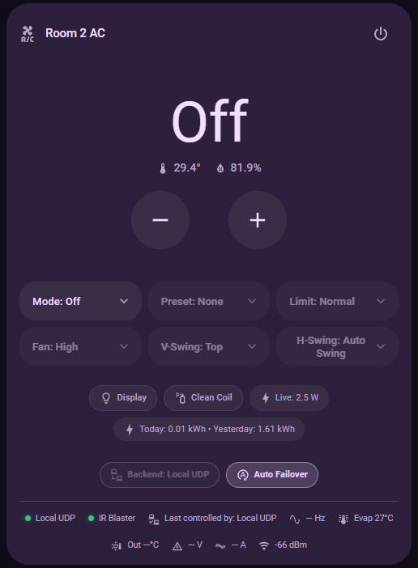
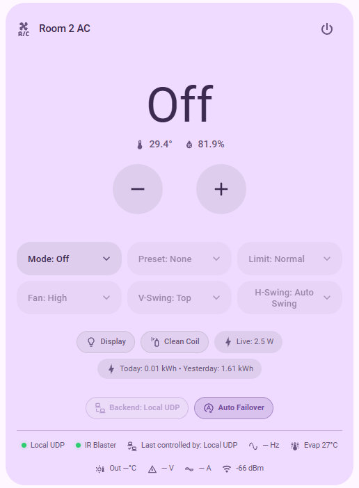
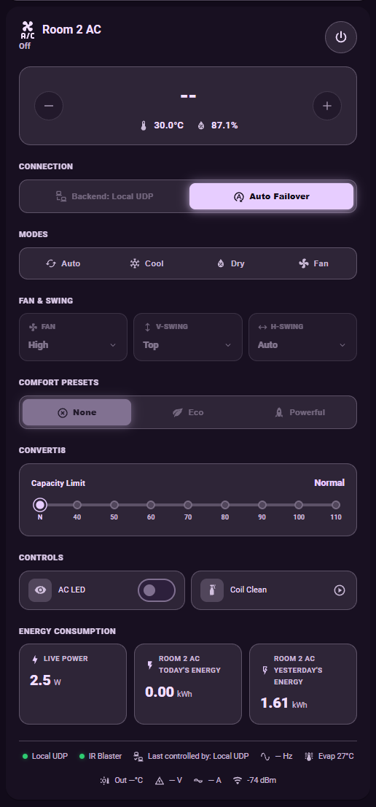
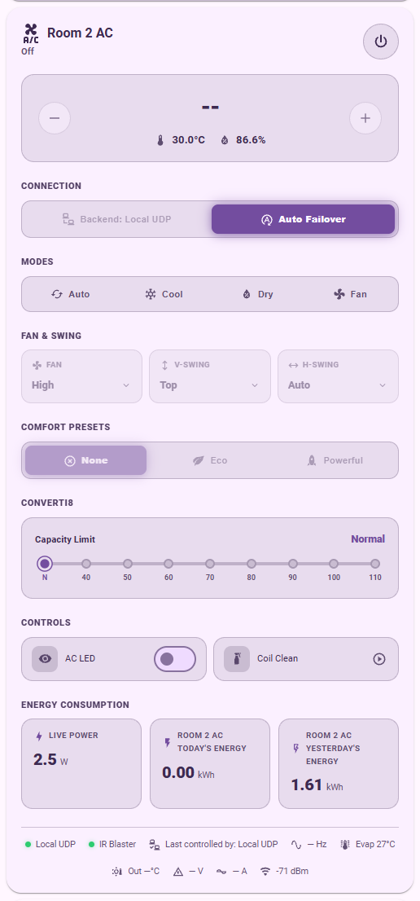
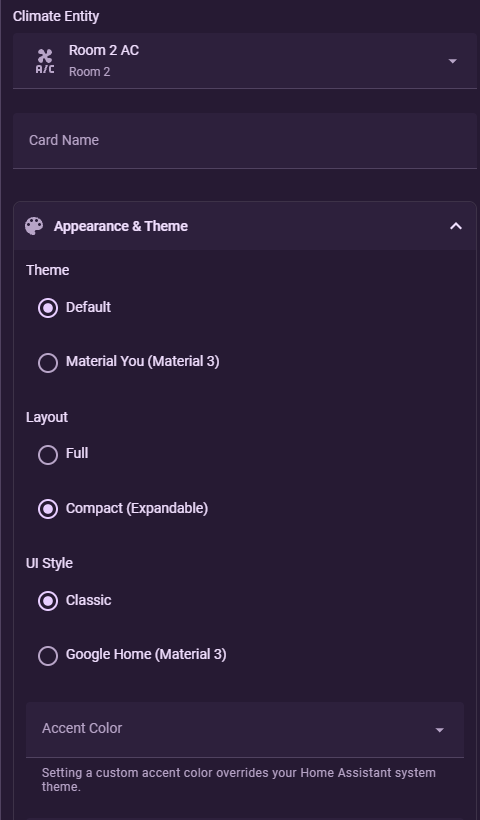
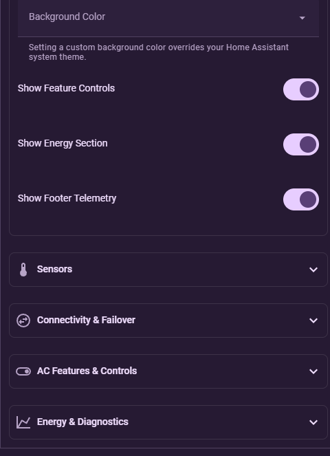

# What's New in Panasonic AC India Card 3.0 (Beta)

> [!NOTE]
> For full 3.0 Beta card setup, screenshots, and YAML options, see the **[Panasonic AC India Card 3.0 Beta README](README-3.0.md)**.

Version `3.0` brings a redesigned **Google Home (Material 3)** style, a custom `ha-form` visual editor, live **Voltage** and **Current** footer telemetry, external smart-plug energy support, and Matter-Only feature handling.

---

## 1. Google Home (Material 3) & Classic UI Styles

Both **Google Home (Material 3)** and **Classic** full views—plus the **Compact (Expandable)** row—are updated for crisp contrast across both Dark and Light Home Assistant themes:
* Active mode chips and dropdown menus use `--miraie-accent` with clear checkmarks (`mdi:check`) for the active option.
* Section visibility toggles (`show_controls`, `show_energy`, `show_diagnostics`) apply cleanly across both Classic and Google Home layouts.

| Google Home (Dark) | Google Home (Light) |
| :---: | :---: |
|  |  |

| Classic (Dark) | Classic (Light) |
| :---: | :---: |
|  |  |

---

## 2. Custom `ha-form` Visual Editor

The card now implements `getConfigElement()` with a native `ha-form` visual editor:
* **Auto-Populated Companion Entities**: Selecting your AC entity automatically fills in matching companion sensors and switches so you can inspect or remove any single field individually.
* **Clear Section Organization**: Grouped into `Appearance & Theme`, `Sensors`, `Connectivity & Failover`, `AC Features & Controls`, and `Energy & Diagnostics`.
* **External Smart-Plug Support**: `Power Sensor` (`estimated_power_sensor`) and `Today Energy Sensor` (`energy_today_sensor`) accept any `power` or `energy` sensor, including external smart plugs.

| Appearance & Theme | Toggles & Collapsible Sections |
| :---: | :---: |
|  |  |

---

## 3. Live Electrical Telemetry & Matter-Only Handling

* **Voltage & Current Footer Pills**: Displays `Voltage (V)` and `Current (A)` from `/diag` telemetry in the diagnostics footer (shown as `—` when idle or unavailable).
* **Matter-Only Mode**: When paired with a standalone Matter AC, unsupported cloud/UDP-only controls are cleanly hidden or greyed out while keeping temperature, mode, and fan controls responsive.
